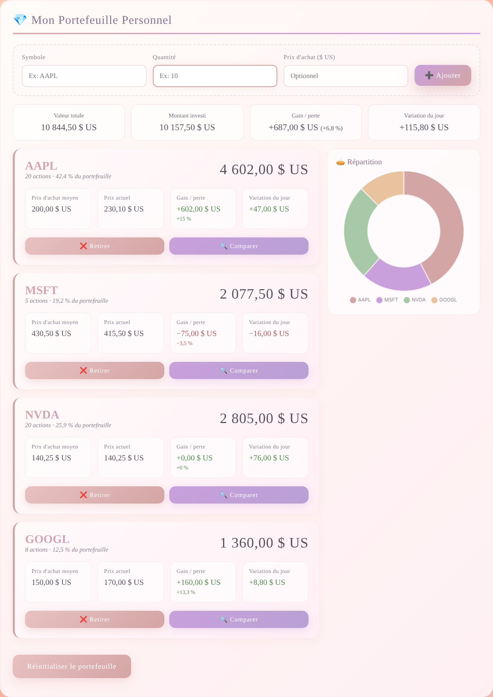
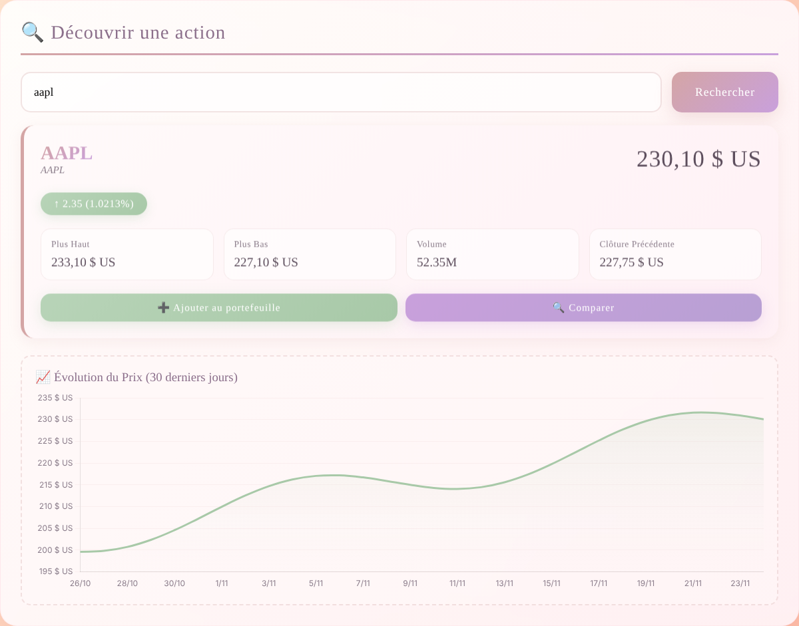
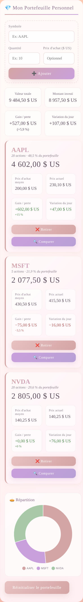

# ✨ SmartWealth

Tableau de bord financier personnel en JavaScript : rechercher une action, voir l'évolution de son prix, suivre un portefeuille avec ses gains et pertes, et comparer plusieurs titres.

**🔗 Démo en ligne : [marwahoumayed22.github.io/SmartWealth](https://marwahoumayed22.github.io/SmartWealth/)**

> Pour essayer la démo sans compte, cliquez sur 🔑 puis « Essayer avec la clé demo » et cherchez **IBM**.



## Fonctionnalités

- **Recherche d'actions** : prix, variation du jour, haut/bas, volume, et graphique des 30 derniers jours (Chart.js).
- **Portefeuille** : ajout de positions (quantité et prix d'achat), **prix moyen pondéré** quand on rachète une même action, gain/perte en $ et en %, variation du jour, et graphique de répartition.
- **Comparaison** de jusqu'à 3 actions côte à côte.
- **Actualités** liées à l'action, avec le sentiment (positif, neutre, négatif).
- **Calculateur** pour simuler un achat.
- **Mode sombre** mémorisé et interface **responsive** (mobile, tablette, ordinateur).

| Recherche | Mobile | Mode sombre |
|---|---|---|
|  |  |  |

*Les captures utilisent des données de démonstration.*

## Technologies

- HTML, CSS (Grid, Flexbox, media queries) et JavaScript (ES2020+, sans framework)
- [Chart.js](https://www.chartjs.org/) pour les graphiques
- API REST [Alpha Vantage](https://www.alphavantage.co/) (`fetch`, `async`/`await`)
- `localStorage` pour le portefeuille, la clé API, le thème et un cache des prix
- Tests unitaires avec `node:test` (inclus dans Node.js, aucune dépendance)

## Choix techniques

- **Logique séparée de l'affichage** : les calculs du portefeuille sont dans `portfolio.js`, sous forme de fonctions pures. Elles ne touchent ni à la page ni à l'API, ce qui permet de les tester.
- **Économie de requêtes** : la clé gratuite permet 25 requêtes par jour. Les prix sont mis en cache 10 minutes, et un message clair s'affiche quand la limite est atteinte.
- **Sécurité** : tout texte venant de l'API est échappé avant d'être affiché (protection XSS), seuls les liens `http(s)` sont acceptés, et les symboles sont validés.
- **Clé API hors du code** : chaque utilisateur entre sa propre clé, qui reste dans son navigateur.
- **Délégation d'événements** : un seul écouteur gère tous les boutons générés dynamiquement (attributs `data-action`), au lieu de `onclick` dans le HTML.

## Lancer le projet

1. Cloner le dépôt, puis ouvrir `index.html` avec un serveur local (par exemple l'extension **Live Server** de VS Code).
2. Obtenir une clé gratuite sur [alphavantage.co](https://www.alphavantage.co/support/#api-key) et l'entrer dans l'appli (bouton 🔑).

## Tests

```bash
npm test
```

13 tests couvrent le prix moyen pondéré, les gains et pertes, la répartition, la validation du formulaire et la conversion des anciennes données.

## Structure

```
index.html            Structure de la page
styles.css            Styles, mode sombre, responsive
app.js                Interface et appels à l'API
portfolio.js          Calculs du portefeuille (fonctions pures)
tests/                Tests unitaires
docs/                 Captures d'écran
```

## Auteure

**Marwa Houmayed** — finissante au baccalauréat en informatique, Université de Montréal
[à compléter — LinkedIn]

*Projet personnel à but éducatif. Ce n'est pas un conseil financier.*
